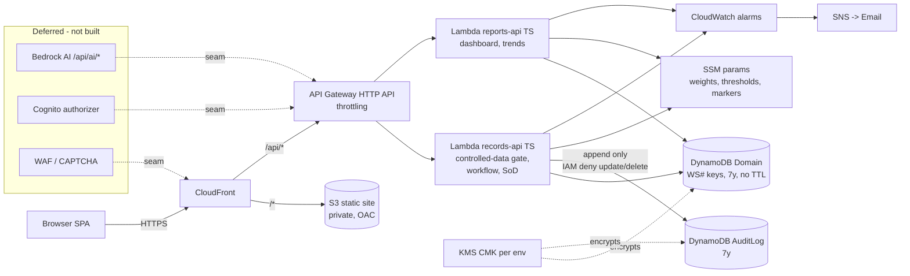
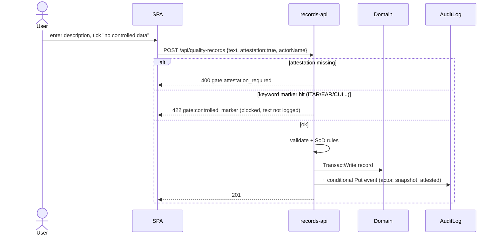

# SentinelQA — Architecture Diagrams
Status: v0.2 (decisions resolved 2026-10-13). See [architecture-overview.md](architecture-overview.md).

## Component view (current build)

## Write with controlled-data gate

## Environments (single account, us-east-1)

